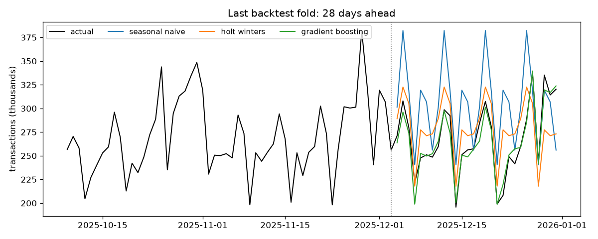
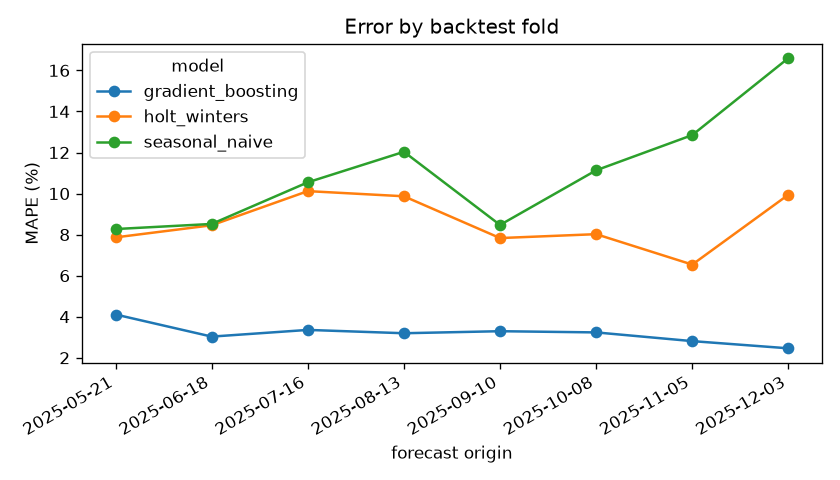

# transaction-forecasting

Forecasting daily wallet transaction volumes four weeks ahead, which is roughly how far in advance capacity, float and agent liquidity need planning.

Transaction volume in Zimbabwe has a few habits that a plain weekly model misses:

- **Payday.** Volumes jump from around the 25th of the month to the 2nd of the next.
- **Day of week.** Fridays are the busiest day and Sundays the quietest.
- **Public holidays.** They look like Sundays. Heroes and Defence Forces Days move around (2nd Monday and Tuesday of August), so they're calculated rather than hard-coded.
- **Level shifts.** A tariff change permanently knocks volume down overnight.

The series is simulated with all of the above (see `data.py`) so the repo can be public. The models don't know how it was generated.

## Run it

```
uv sync
uv run python -m transaction_forecasting.backtest
uv run pytest
```

## How it's evaluated

It uses a rolling-origin backtest: cut the history at 8 points, forecast the next 28 days from each cut, and compare against the actual values. A single train/test split on a time series tells you very little, because one bad (or lucky) month can swing the result.

| model | mean MAPE | std | worst fold |
|---|---|---|---|
| seasonal naive (same day last week) | 11.1% | 2.8 | 16.6% |
| Holt-Winters, damped trend, weekly season | 8.6% | 1.3 | 10.1% |
| gradient boosting on calendar features | **3.2%** | 0.5 | 4.1% |



The chart shows the main problem with the two classical models. They only know about a 7 day cycle, so the payday bump either gets copied into the wrong week (seasonal naive repeats the last week before the cut, which happened to be payday week) or gets smeared across every week (Holt-Winters). The boosted model gets payday and holidays as features, so it puts them in the right place.

Trees can't extrapolate a trend, so before fitting I take out a straight line through the last six months of log volume and add it back afterwards. Without that step it underforecasts every fold. Older data is also given less weight so the model doesn't keep expecting pre-tariff volumes.



## Not done yet

- Easter (it moves, and I haven't added the date calculation)
- Prediction intervals. Ops cares more about "how high could it go" than about the point forecast.
- Trying it on real data, where payday is much messier (civil servants, NGOs and the private sector are paid on different dates)
